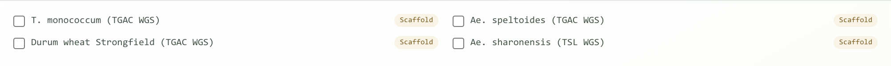
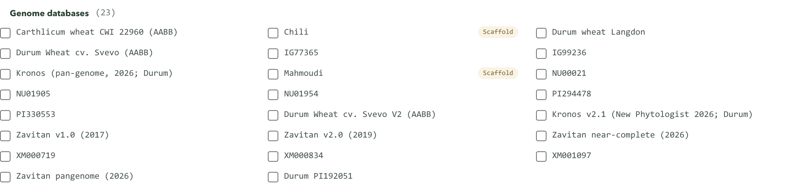

# Zavitan 四套组装的统一命名（2026-11-23）

平台上有四套不同的野生二粒小麦组装都被叫作 Zavitan，但 BLAST 显示磁盘库名、
JBrowse 网关页显示手写卡片标题、`genome_registry` 与 `Genefunc_registry` 又各有一套写法，
四者在页面上对不上。本次只统一**显示名**，不动任何库名/目录名。

| 显示名 | dataset_id | BLAST 库（不变） | JBrowse `data=`（不变） | 论文 |
|---|---|---|---|---|
| Zavitan v1.0 (2017) | `Wild_emmer` | `AABB_Wild_emmer.genome` | `Wild_emmer` | Avni 2017 Science, 10.1126/science.aan0032 |
| Zavitan v2.0 (2019) | `Wild_emmerV2` | `AABB_Wild_emmerV2.genome` | `Wild_emmerV2` | Zhu 2019 G3（光学图谱）, 10.1534/g3.118.200902 |
| Zavitan near-complete (2026) | `AABB_Wild_emmer_Zavitan` | `AABB_Wild_emmer_Zavitan.genome` | `AABB_Wild_emmer_Zavitan` | Yi 2026 Nat Genet（WEW_NT）, 10.1038/s41588-026-02808-3 |
| Zavitan pangenome (2026) | `Zavitan` | `AABB_Zavitan.genome` | `Zavitan` | Bian 2026 Nat Genet（四倍体泛基因组）, 10.1038/s41588-026-02678-9 |

## 改动

- 显示名来源：`genome_registry.display_name` → `/api/blast/databases` 的
  `database_meta[db].display_name` → BLAST 选择器；JBrowse 卡片标题手写同一串。
- 数据：`scripts/sql/zavitan_unified_names_20261123.sql`
  - 修复 `genome_registry` 三处 DOI 错位（v1/v2 互换、WEW_NT 写成 v1 的 DOI）及
    journal/year/paper_title；
  - `Genefunc_registry` 名称对齐、`Wild Ember` 拼写、补两个 DOI；
  - 重复注释表 `Genefunc_Zavitan_table` 隐藏（与 `Genefunc_AABB_Zavitan_table`
    同为 97,882 个基因模型，仅染色体大小写不同），数据保留，可 `visible=1` 回滚。
- 代码：`app/api/routers/blast.py`、`app/static/blast2/index.html`、
  `app/static/docpages/jbrowse.html`、`scripts/rebuild_genome_registry.py`。

## 验证

- BLAST 搜 “Zavitan” 出 4 套组装（按 v1.0 → v2.0 → near-complete → pangenome），
  逐染色体库带 `· Chr1A` 后缀（`screenshots/blast-tetraploid-genomes.png`）。
- JBrowse 同四张卡片标题一致，DOI 正确（`screenshots/jbrowse-aabb-zavitan.png`）。
- `GET /api/blast/database/{db}/jbrowse` 对四个库分别解析到
  `Wild_emmer` / `Wild_emmerV2` / `AABB_Wild_emmer_Zavitan` / `Zavitan`。

约定与维护步骤见 `MAINTENANCE.md` §十“BLAST 选择器显示名 = JBrowse 卡片标题”。

## 后续（同日）：其余 scaffold 级组装

第一轮只处理了四套 Zavitan，BLAST 里还有 13 个 genome 库在显示磁盘库名，分两类处理：

1. **确有独立组装的 5 个**（Paragon / Robigus / Weebill / Chili / Mahmoudi）：
   `genome_registry` 里没有 `blast_genome_db` 链接，补上后自动显示 registry 的
   display_name（Paragon、Robigus、Weebill 还补了 scaffolds 的 CDS/PEP；Chili /
   Mahmoudi 补了 AABB 倍性与物种）。见
   `scripts/sql/scaffold_blast_links_20261123.sql`。
2. **四套野生近缘 WGS contig 组装的 8 个重复构建**：`Other_TGAC_WGS_*` /
   `Other_TSL_WGS_*` 是 2026-09 重建版（有 `.fai`，getfasta 在用），同名的
   `TGAC_WGS_*` / `TSL_WGS_*` 是 2024 年的两份旧索引，序列条数与总长完全相同。
   旧索引列入 `SUPERSEDED_WGS_BUILDS` 不再出现在选择器（与 `DUPLICATE_ALIAS_DBS`
   同一规则）；保留的 4 个没有 registry 行、也不在 JBrowse，标签放在
   `BLAST_ONLY_LABELS`，不塞进 genome 目录。

另外把 `chromosome_count` 的语义统一成“染色体数”：四套 Zavitan 都是 14
（此前的 114 / 818 / 15 是 `.fai` 行数，含 unplaced / ChrUn）。

