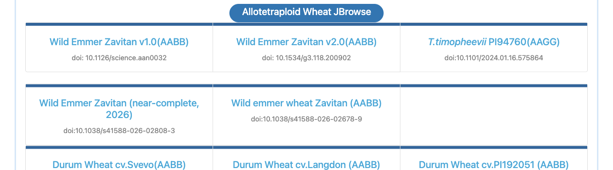
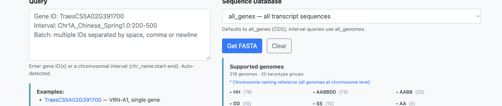
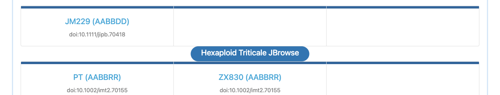
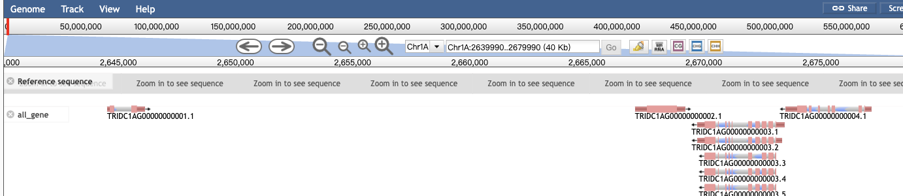

# 本周小麦及其近缘基因组更新速览（2026.10.19–10.23）

过去一周，小麦及近缘物种又有 4 篇论文报道新基因组、共 5 个基因组完成组装并在 WheatOmics 上线：野生二粒小麦 Zavitan 近完整基因组、十倍体长穗偃麦草、六倍体小黑麦 PT/ZX830，以及济麦229。以下简要介绍，并附网页与 API 入口，方便直接检索使用。

## 一、野生二粒小麦 Zavitan 近完整基因组（AABB，10.47 Gb）

用 PacBio HiFi、ONT 超长读长与 Hi-C 将 Zavitan 组装到近完整：14 条染色体锚定率 99.81%，contig N50 74.58 Mb，14 个着丝粒全部解析（6.3–9.2 Mb），补回约 400 Mb 缺口序列。结合 CENH3 ChIP-seq 定位功能着丝粒后发现：A 亚基因组以 CRW 富集块位移与序列周转为主，B 亚基因组则表现为 CentT566 卫星减少、局部保留或扩增。

> Yi C, Liu Q, Shen L, et al. Near-complete assembly of wild emmer wheat unveils centromere reorganization during polyploid evolution. *Nature Genetics*, 2026. doi:10.1038/s41588-026-02808-3

**平台入口**：JBrowse「Allotetraploid Wheat」分区卡片 *Wild Emmer Zavitan (near-complete, 2026)*（同区另有泛基因组版 *Wild ember wheat Zavitan (AABB)*，DOI 10.1038/s41588-026-02678-9，注意区分）；Web BLAST 染色体组；GetSequence 归入 Tetraploid wheat genome；基因功能查询可检索 92,943 基因 / 188,115 转录本；PrimerServer2 可用。

## 二、十倍体长穗偃麦草（Thinopyrum ponticum，约 40 Gb）

完成 40 Gb 十倍体长穗偃麦草的同源等位基因分辨组装（43,628 条序列），揭示广泛同源交换与区段性异源多倍化，为小麦远缘杂交与抗性基因发掘提供参考。

> Deng P, Xie J, Li X, et al. The homoeolog-resolved assembly of the 40-Gb decaploid Thinopyrum ponticum genome reveals extensive homoeologous exchange and recombination, segmental allopolyploid organization, and allelic variations for wheat improvement. *Molecular Plant*, 2026. doi:10.1016/j.molp.2026.09.014

**平台入口**：JBrowse「Other Triticeae species」；Web BLAST 染色体组；GetSequence 新增 **Thinopyrum ponticum** 独立分类（下图 216 个基因组 / 20 个核型组）；基因功能表已接入。

## 三、六倍体小黑麦 PT 与 ZX830（AABBRR）

两套近完整组装揭示 R 亚基因组的染色体结构变异与着丝粒分化，并发现这与生殖隔离相关；PT 含 21 条染色体 + 151 条未定位序列，ZX830 为 21 条染色体。

> Liu Y, He W, Wang C, et al. Two near-complete assemblies reveal R-subgenome structural and centromeric divergence associated with reproductive isolation in hexaploid triticale. *iMeta*, 2026. doi:10.1002/imt2.70155

**平台入口**：JBrowse「Hexaploid Triticale」两张卡片；Web BLAST 新增「Hexaploid Triticale genome (AABBRR)」分组；GetSequence 归入 Triticale (AABBRR)；基因功能表与 PrimerServer2 均已接入。

## 四、济麦229（JM229，AABBDD，21 条染色体）

完成济麦229 染色体水平组装，结合比较基因组学解析小麦面筋品质相关的隐藏遗传决定因素。

> Zhang J, Wang Z, Zhang W, et al. Comparative genomics reveals hidden genetic determinants of wheat gluten quality. *Journal of Integrative Plant Biology*, 2026. doi:10.1111/jipb.70418

**平台入口**：JBrowse「Allohexaploid Wheat」分区中的 *JM229 (AABBDD)* 卡片；Web BLAST 染色体组与 All genomes 聚合库；GetSequence 归入 Hexaploid wheat genome；PrimerServer2 可用。基因注释待作者公开 GFF 后补充。

## 网页与 API 入口

- **网页**：JBrowse（浏览基因结构/取序列）、Web BLAST、GetSequence（按 ID/区间取 FASTA）、PrimerServer2、基因功能查询、基因组信息库。
- **REST API**：全站标准化接口，文档 https://wheatomics.sdau.edu.cn/api/docs ，机器可读 OpenAPI：`/api/openapi.json`（当前 88 个接口）。新基因组可直接调用，例如：
  - `GET /api/genomes?ploidy=AABBRR`（小黑麦）、`GET /api/jbrowse/datasets`
  - `GET /api/sequence/by-interval?region=Chr1A_Wild_emmer_Zavitan:200-500&database=all_genomes`
  - `GET /api/blast/databases`（含新库）
- **JBrowse 配置与轨道数据**：`GET /api/jbrowse/datasets/{dataset}/trackList`（与页面配置一致，可直接取轨道定义）；静态 `trackList.json`、`seq/refSeqs.json`、`tracks/…/trackData.json` 也可直接 HTTP 获取，便于脚本批量取某条染色体的基因坐标。
- **MCP / AI Agent**：`GET /api/mcp/sse`、`POST /api/mcp/messages`，Claude、ChatGPT 等可直接连接平台数据；把 `/api/openapi.json` 交给 AI，即可让其自动生成「WheatOmics 数据查询」技能。

往期介绍见公众号文章：[《WheatOmics 网站升级公告｜AI 智能访问 · 数据全面升级》](https://mp.weixin.qq.com/s/lOaZ-Fpz5CDyz7p_wwGSOg)、[《WheatOmics 2.0 之如何更好地用好网站数据和工具》](https://mp.weixin.qq.com/s/OdyBcd3o7eaTY2DozxXdxw)、[《WheatOmics 2.0 之单基因探索分析篇》](https://mp.weixin.qq.com/s/1ZhjfdWnbihKjjKvh-Te2w)。

平台当前覆盖：219 个 JBrowse 数据集、3,128 个 BLAST 库、302 个基因组、332 套表达谱项目、22,172 篇小麦族文献（1884–2026）、VariantHub 3 套参考基因组 29 个变异数据集。

数据持续更新，若发现注释或序列问题欢迎反馈；引用时请同时引用原文文献与 WheatOmics 平台。

---

*（配图均截自 wheatomics.sdau.edu.cn，2026-10-23；接口统计截至发稿）*
